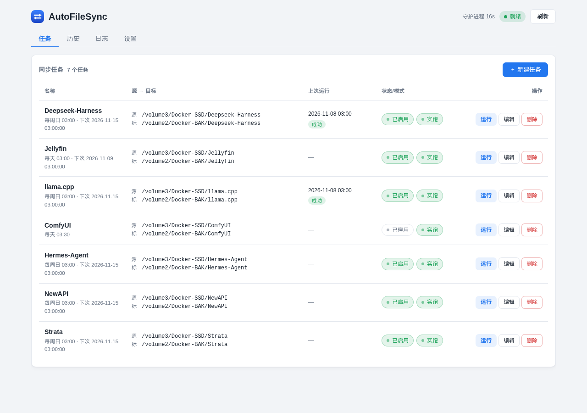
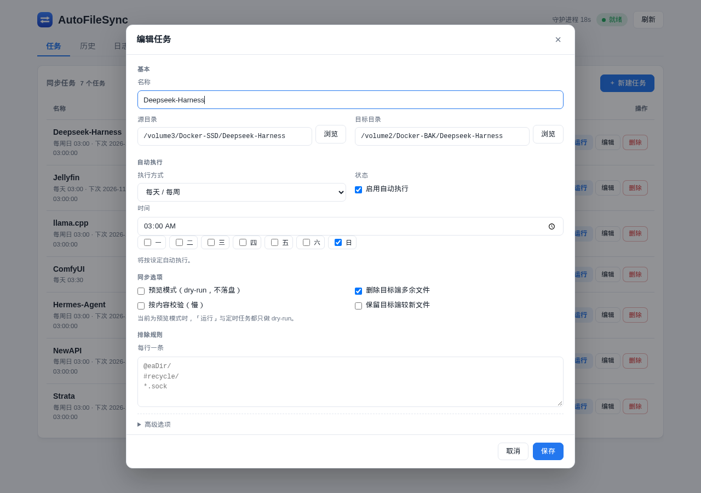
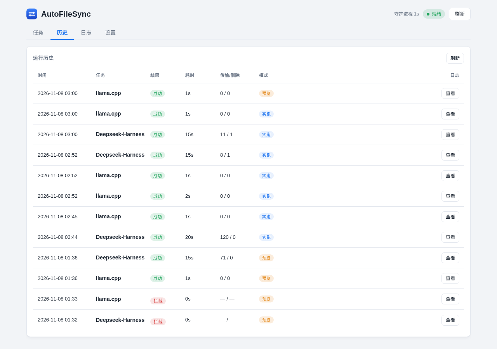
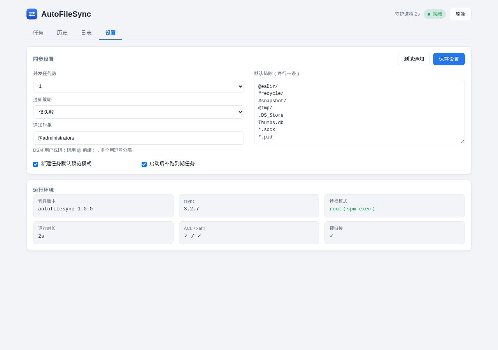
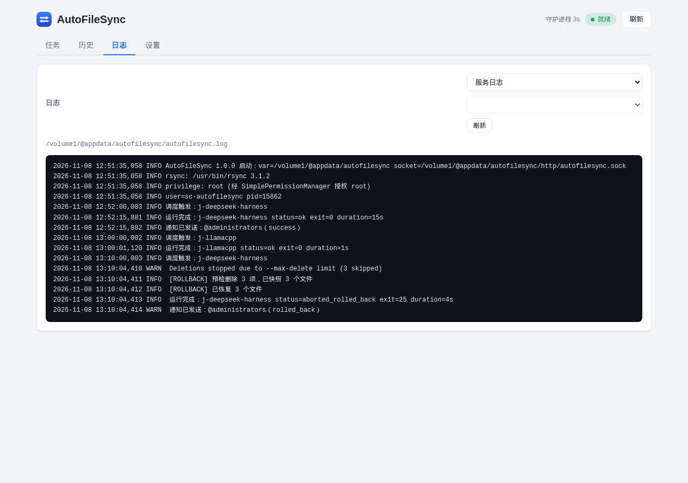

# AutoFileSync

在群晖 DSM 7 上管理 **rsync 文件夹镜像同步** 的原生套件。

安装后从 DSM 主菜单打开 AutoFileSync，即可新增、编辑、启停同步任务；源目录、目标目录、排除规则、执行计划全部在图形界面里配置，不需要 SSH、crontab 或改脚本。



## 功能

- **任务完全自定义**：任意源/目标目录，可新增、编辑、删除、启停；目录可用内置浏览器选择
- **两种运行模式**：`预览`（dry-run，只报告不落盘）/ `实跑`，运行中可取消
- **自动执行**：每隔 N 分钟，或每天/每周指定时间；每个任务独立启停
- **并发执行**：1–3 个任务同时跑，超出的任务自动排队
- **删除策略**：删除目标端多余文件，支持 `--max-delete` 上限
- **删除超限回滚**：实跑前只记录本次将被删除的文件（硬链接快照，不复制数据）；正常结束或回滚完成后立即清理，不留长期回收站
- **安全护栏**：
  - 源/目标路径校验，禁止系统目录、卷根、`@`/`#` 系统目录
  - `--delete` 时源目录必须非空
  - 目标目录非空时需显式「确认接管」（写入 `.autofilesync-target` 标记）
  - 目标卷身份（`st_dev`）校验，避免卷未挂载时写错位置
  - 删除上限、单任务锁、超时、剩余空间检查
- **通知**：DSM 桌面通知；可选「仅失败 / 每次 / 不通知」，收件人支持 DSM 用户和 `@群组`；预览运行不通知
- **可观测**：每次运行的独立日志、最近 200 条运行历史、rsync 统计解析
- **零端口**：UI → `api.cgi` → unix socket → 守护进程，不监听任何 TCP 端口
- **noarch**：纯 Python 标准库 + 系统自带 rsync，一个包覆盖全部 DSM 平台

## 截图

| 任务列表 | 编辑任务 |
|---|---|
|  |  |

| 运行历史 | 设置 |
|---|---|
|  |  |



## 安装

要求：**DSM 7.0 及以上**，系统自带 `rsync`（DSM 默认已安装）。

1. 从 [Releases](../../releases) 下载 `autofilesync_noarch-dsm7_*.spk`
2. DSM → **套件中心** → **手动安装** → 选择下载的 `.spk`
3. 安装向导会提示：安装完成后请在 **SimplePermissionManager（权限管理器）** 中授权 AutoFileSync
4. 安装完成后，在 SimplePermissionManager 中授权；如果尚未安装它，请先从套件中心安装
5. DSM 主菜单 → **AutoFileSync**

> 未授权也可以使用，但同步会以 `sc-autofilesync` 身份运行：无法保留 uid/gid/ACL，且可能无法读取或删除不属于该用户的文件。

> 安装时提示「发布者未经验证」属于第三方套件的正常提示。

## 权限说明

DSM 7 要求第三方套件以 `package` 用户运行，因此套件本身不使用 `run-as: root`。

需要 root 的操作（保留 uid/gid/ACL、删除目标端文件等）通过 **SimplePermissionManager** 提供的 `spm-exec` 执行。

在 SPM 中授权 **AutoFileSync** 套件即可；SPM 会把它映射到包用户 `sc-autofilesync`（uid），`spm-exec` 最终按该 uid 校验。

- 通常只需要在 SPM 中勾选 AutoFileSync 套件
- 如果 SPM 把「套件」和「用户」分成两个列表，确认 `sc-autofilesync` 也是启用状态即可，不需要额外的特殊操作
- 未授权时会自动降级为包用户运行（`--no-owner --no-group`），同步仍可工作，但无法完整保留属主信息

> 注意：授权是按 uid 绑定的。卸载重装后如果包用户 uid 变化，旧授权可能失效，需要重新勾选一次 AutoFileSync。

验证当前是否真的拿到 root：

```bash
id sc-autofilesync
sudo -u sc-autofilesync /usr/local/bin/spm-exec id   # 输出 uid=0 才算生效
```

应用内「设置 → 运行环境 → 特权模式」会实际调用 `spm-exec id` 探测，显示的 `root（spm-exec）` 就是当前真实状态，不是配置缓存。

## 快速开始

1. 打开 AutoFileSync，点 **＋ 新建任务**
2. 填写任务名称，选择源目录和目标目录
3. 在「自动执行」中选择执行方式；需要定时运行就勾选「启用自动执行」
4. 排除规则按行填写，例如 `@eaDir/`、`#recycle/`、`*.tmp`
5. 先保持「预览模式」，点任务行「运行」确认变更
6. 确认无误后切到「实跑」，再按需要启用定时

目标目录非空且未接管时，任务行会显示「待接管」，点「接管」写入标记即可。

## 卸载与数据

在套件中心卸载时，向导会询问如何处理套件数据：

- **保留（默认）**：配置、任务、历史与日志保留在 `/volume1/@appdata/autofilesync`，重新安装后可继续使用
- **删除**：清除全部配置、任务、历史与日志，不可恢复

通过命令行 `synopkg uninstall` 卸载不会出现向导，默认保留数据。

## 通知

在「设置 → 通知」中配置：

- **通知策略**：`不通知` / `仅失败` / `每次`
- **通知对象**：DSM 用户名或群组，多个用英文逗号分隔
  - `@administrators`：管理员群组
  - `1114788662`：指定用户
  - `@administrators, 1114788662`：群组 + 个人

通知发送到 DSM 桌面右上角的通知中心，不是邮件或短信。预览运行不会发送通知；可在设置页点「测试通知」验证通道。

## 安全说明

- 删除操作不可撤销；建议第一次先跑「预览」
- 「删除上限」触发时，套件会用本次运行前记录的被删文件自动回滚，然后清理快照
- 取消、超时或其他失败时，快照会保留在目标目录 `.autofilesync-trash/` 下，日志中会给出路径；下次运行会自动清理超过 1 天的残留
- 快照目录已从同步中排除，不会被反向拷贝

## 构建

```bash
./build.sh
# 产物：dist/autofilesync_noarch-dsm7_<version>.spk
```

依赖：`bash`、`tar`、`gzip`、`md5sum`、`python3`。不需要 Synology SDK。

## 目录结构

```
AutoFileSync-DSM/
├── build.sh                     # 打包脚本
├── spk/
│   ├── INFO                     # 由 build.sh 生成
│   ├── conf/privilege           # run-as: package
│   ├── scripts/                 # 安装/升级/启停钩子
│   └── var-default-config.json  # 首装默认配置
├── src/
│   ├── bin/autofilesync-daemon.py   # 调度、执行、护栏、API
│   └── ui/                          # 单页界面、api.cgi、DSM 应用注册、i18n
├── tools/                       # 图标生成、本地开发服务器
└── docs/screenshots/
```

## 已知限制

- 仅支持本机路径同步，暂不支持远程 rsync（`user@host:path`）
- 通知仅限 DSM 桌面通知，不发送邮件
- 并发数上限为 3；目标盘相同时并行不一定更快

## 开发与维护

项目目标、验证环境、Git 流程、版本规则与安装/卸载向导说明见 [docs/PROJECT.md](docs/PROJECT.md)。

## License

[MIT](LICENSE)
